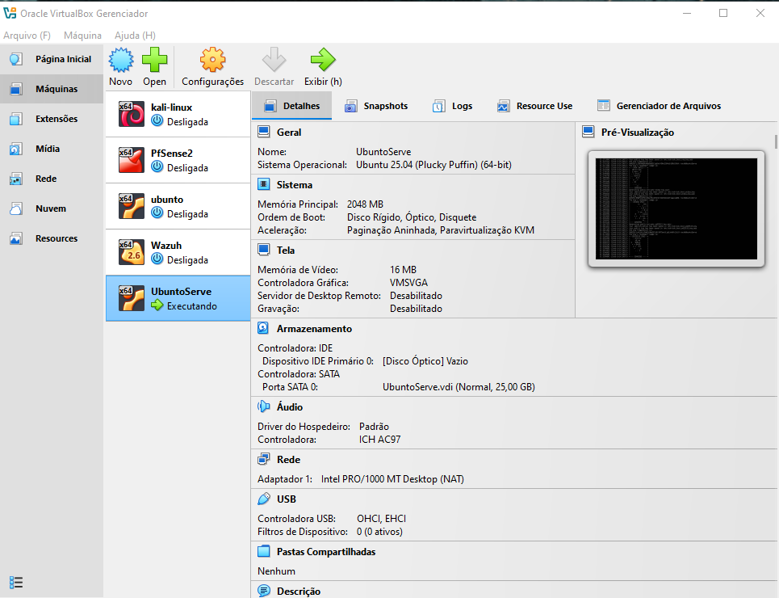
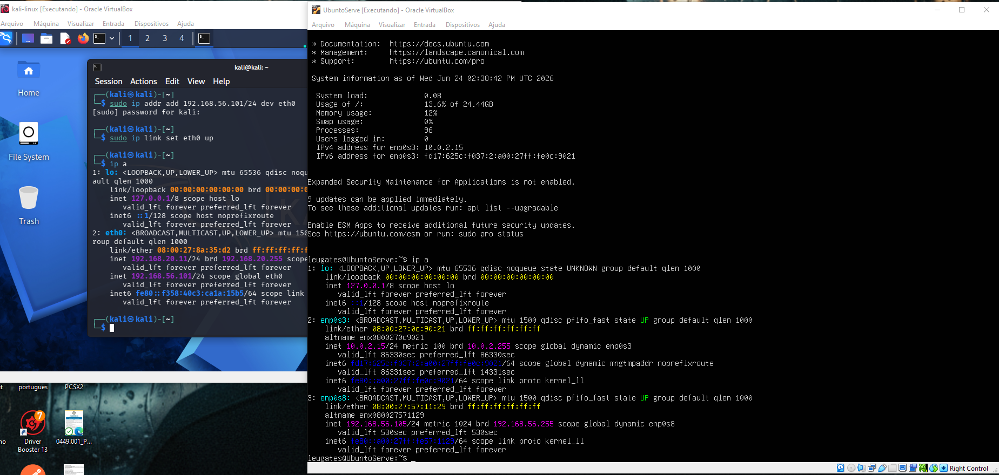
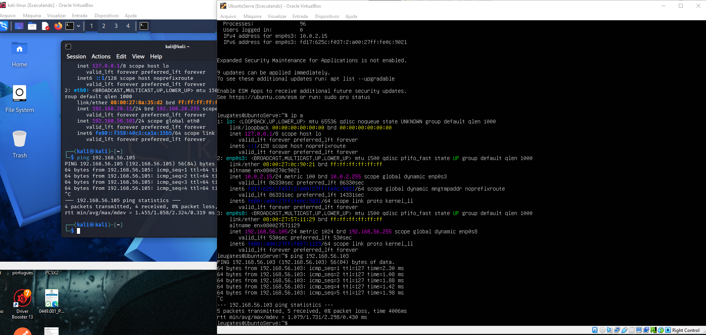
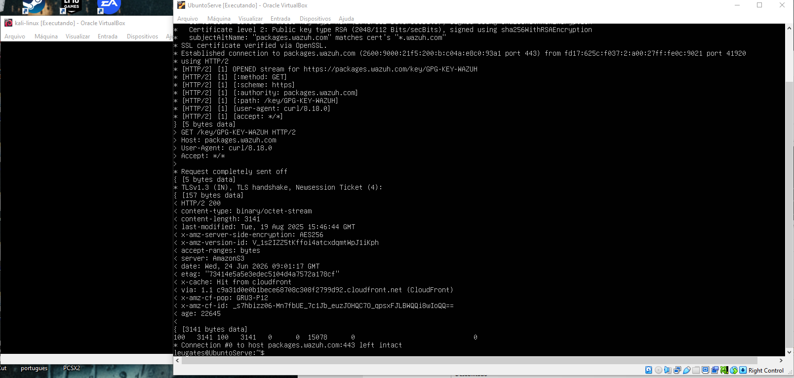
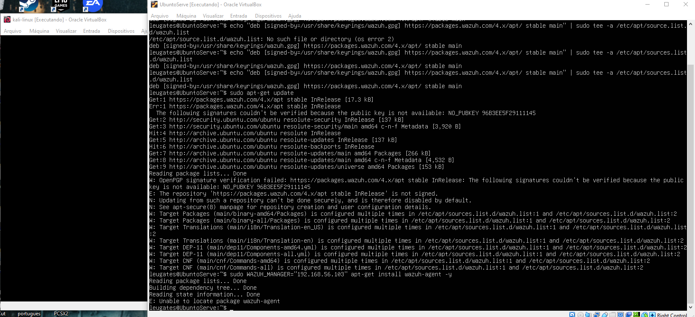
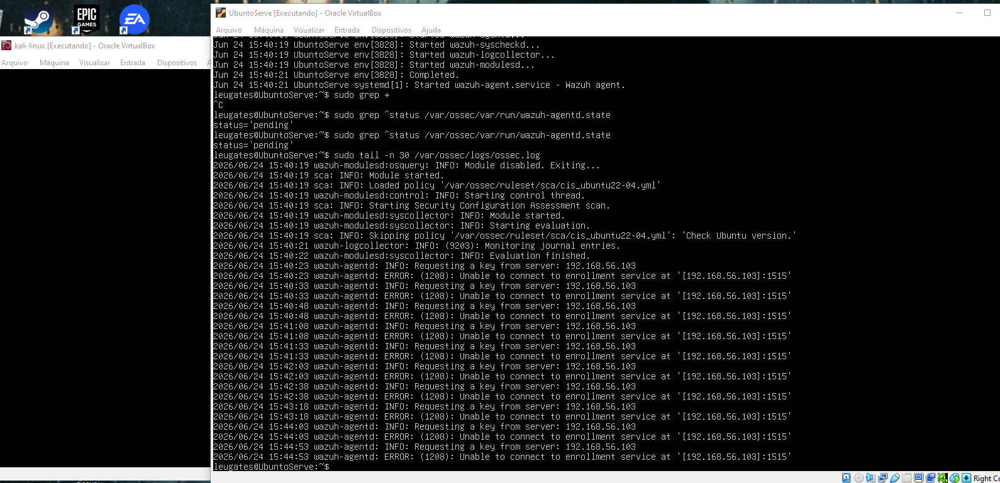
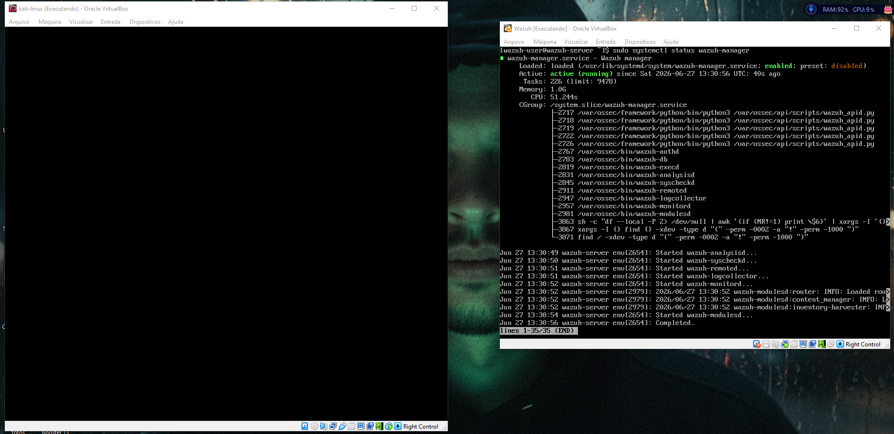
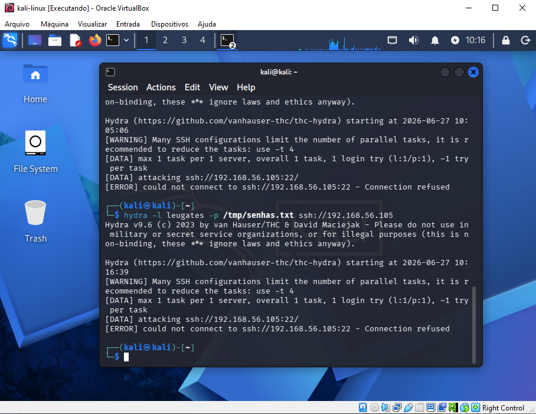
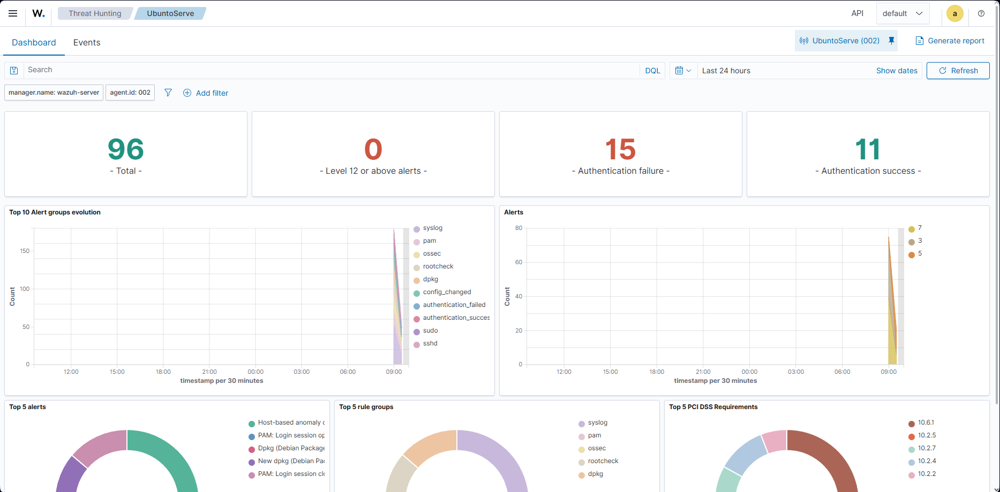

# Laboratório SOC — Kali Linux + Wazuh + Ubuntu Server

Projeto prático de um ambiente de **SOC (Security Operations Center)** montado do zero em máquinas virtuais, simulando um cenário real de Red Team vs Blue Team: ataques controlados de um lado, detecção e monitoramento de segurança do outro.

## Objetivo

Construir um ambiente completo onde fosse possível:
- Simular ataques reais contra um servidor (força bruta SSH)
- Detectar esses ataques em tempo real usando um SIEM open source (Wazuh)
- Validar, na prática, o funcionamento de ponta a ponta de um pipeline de monitoramento de segurança

## Arquitetura

| Máquina | Papel | Sistema |
|---|---|---|
| **Kali Linux** | Atacante (Red Team) | Kali rolling |
| **Wazuh** | SIEM / Manager (Blue Team) | Ubuntu Server |
| **UbuntuServe** | Alvo monitorado | Ubuntu Server 25.04 |

Todas as VMs foram configuradas no VirtualBox com **dois adaptadores de rede**:
- **NAT** → acesso à internet (atualizações, download de pacotes)
- **Host-Only** → rede isolada exclusiva entre as três VMs (faixa `192.168.56.0/24`)



## Passo a passo

### 1. Preparação das VMs e rede

Criação das três VMs e configuração da rede Host-Only para que elas se enxergassem entre si. Esse foi o passo que mais exigiu troubleshooting: inicialmente cada VM caiu em uma faixa de IP diferente (`192.168.55.x` vs `192.168.56.x`) por estarem usando adaptadores Host-Only distintos do VirtualBox. Após padronizar o adaptador em todas as VMs, a comunicação foi validada com `ping`.





### 2. Instalação do agente Wazuh no UbuntuServe

Processo de adicionar o repositório oficial da Wazuh, importar a chave GPG e instalar o `wazuh-agent` apontando para o IP do manager.

**Problemas encontrados e resolvidos:**
- Erro de digitação na URL da chave GPG (`https?` em vez de `https:`, depois `package` em vez de `packages`)
- Arquivo de repositório (`wazuh.list`) duplicado, causando falha de assinatura (`NO_PUBKEY`)
- Corrigido reimportando a chave do zero e recriando o arquivo de repositório uma única vez





### 3. Conexão do agente com o manager

Depois de corrigir um timeout na subida do `wazuh-manager` (serviço "morria" sozinho no boot — resolvido com `systemctl start` manual), o agente conseguiu se registrar na porta de enrollment (1515) e passou para o status `connected`.





### 4. Simulação de ataque (Hydra — brute force SSH)

Com o SSH habilitado no UbuntuServe, foi executado um ataque de força bruta a partir do Kali usando o **Hydra**, testando uma lista de senhas contra o usuário do servidor.

```bash
hydra -l leugates -P /tmp/senhas.txt ssh://192.168.56.105
```



### 5. Detecção no dashboard do Wazuh

O ataque foi detectado e exibido no painel **Threat Hunting** do Wazuh em poucos segundos, confirmando o funcionamento completo do pipeline de monitoramento:

- **15** falhas de autenticação detectadas
- **11** autenticações bem-sucedidas
- Alertas categorizados por grupo: `authentication_failed`, `sshd`, `pam`
- Pico de eventos visível na linha do tempo, coincidindo com o horário do ataque



## Resultado

Com esse laboratório foi possível validar, na prática, um pipeline de detecção de segurança completo:

```
Kali (ataque) → rede isolada → UbuntuServe (alvo + agente) → Wazuh Manager → Dashboard (alertas)
```

## Próximos passos (em andamento)

- [ ] **Active Response** — bloqueio automático do IP atacante via `iptables` quando o Wazuh detecta múltiplas falhas de autenticação
- [ ] File Integrity Monitoring (FIM) — detectar alteração de arquivos sensíveis
- [ ] Simulação de exploração de CVE conhecido via Metasploit
- [ ] Dashboard customizado e relatório PDF para documentação

## Tecnologias utilizadas

`VirtualBox` · `Kali Linux` · `Wazuh 4.14` · `Ubuntu Server 25.04` · `Hydra` · `SSH` · `iptables` (planejado)

---

*Projeto pessoal de estudo em Segurança da Informação / SOC N1, com foco em Blue Team.*
